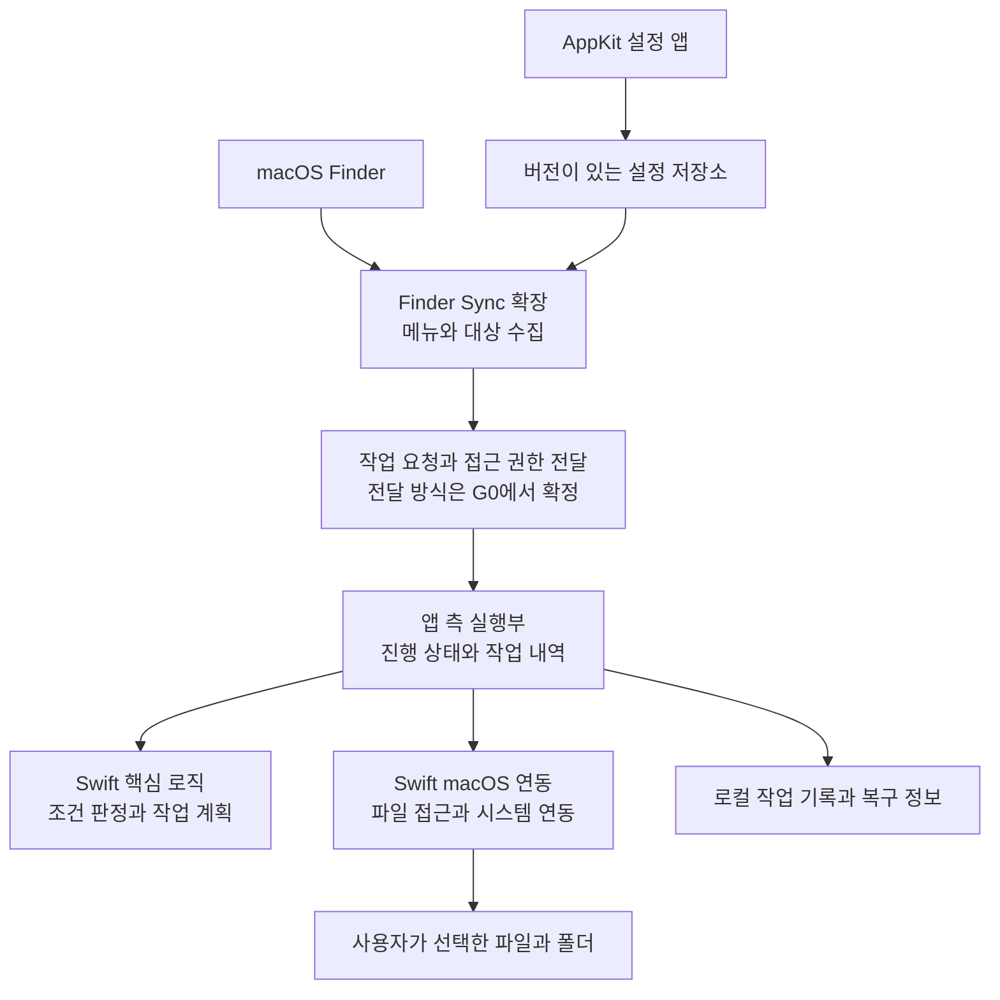

# Alright 제품·기술 청사진

> Current behavior: version 0.5.0 creates PSD/AI at screen pixel dimensions and ends with Finder filename editing. See [Document creation](DocumentCreation.md).

작성일: 2026-09-20 · 상태: 구현 전 설계 · 플랫폼: macOS

2026-09-24 현황: [Hello World 호스트](HelloWorld.md)를 구현하였다. 이 문서의 Finder 기능·시장·배포 항목은 원래의 설계이며 기능 구현 완료를 뜻하지 않는다.

2026-09-25 현황: [Finder New Text](FinderNewText.md)를 구현하여 등록 폴더의 빈 공간 메뉴에서 빈 TXT 생성·기본 편집기 열기를 실증하였다. 이번 기능의 메뉴 이름은 사용자 요구에 따라 최상위 `New Text`이다. 아래 다기능 Alright 하위 메뉴는 후속 설계이다.

## 1. 제품 정의

Alright는 Finder의 우클릭 메뉴에 파일 생성과 반복 정리 작업을 더하는 앱이다. 고객이 구매하는 가치는 메뉴의 개수가 아니라, 파일 작업 중 다른 앱을 열거나 폴더를 찾아다니는 횟수의 감소이다.

첫 고객은 Windows의 파일 작업 방식에 익숙한 Mac 사용자와, 파일·문서를 자주 생성하고 전달하는 디자이너·개발자·운영 실무자이다. 첫 사용 시나리오는 “프로젝트 폴더에서 우클릭하여 Markdown 파일 생성 → 경로 복사 → 완료된 파일을 지정 폴더로 이동”이다.

제품 약속은 **“필요한 파일 작업을 지금 클릭한 위치에서 끝낸다”**이다. Finder 전체를 대체하는 파일 관리자, 클라우드 저장소, 시스템 최적화 도구로 범위를 넓히지 않는다.

### 문제를 구분한다

| 사용자 불편 | 판단 | Alright의 해법 |
| --- | --- | --- |
| 현재 폴더에서 문서를 바로 만들기 어렵다 | 핵심 기회 | 빈 공간에서 TXT·Markdown 및 유효한 템플릿 생성 |
| 경로를 복사하려면 기능 위치를 알아야 한다 | 발견성 문제 | 명시적인 경로 복사와 출력 형식 제공 |
| 정리할 때 목적지 폴더를 반복해서 찾아야 한다 | 반복 작업 문제 | 즐겨찾는 목적지로 복사·이동 |
| Windows처럼 잘라내기·붙여넣기를 기대한다 | 익숙함의 차이 | 후속 버전에서 이동 대기·여기로 이동 제공 |
| 메뉴가 지나치게 길어지는 것은 싫다 | 설계 제약 | 기본 Alright 하위 메뉴와 문맥별 노출 |

Finder에는 이미 클립보드 파일 이동(Option-Command-V)이 있으며, 경로 막대에서 경로 복사도 가능하다. 빠른 동작에는 PDF 생성·이미지 회전 등이 있다. 따라서 “Mac에 이동·경로 복사·파일 가공이 없다”라는 주장을 마케팅에 사용하지 않는다. [Apple 단축키](https://support.apple.com/en-us/102650), [파일 정보와 경로](https://support.apple.com/en-asia/guide/mac-help/mchlp1774/mac), [빠른 동작](https://support.apple.com/en-lamr/guide/mac-help/-mchl97ff9142/mac)

## 2. 시장과 차별점

| 비교 대상 | 확인한 제공 가치 | 제품 결정 |
| --- | --- | --- |
| Finder 기본 기능 | 복사·이동, 경로, 빠른 동작 | 기능 부재보다 접근성과 반복 작업 단축을 강조 |
| New File Menu | Finder 문맥에서 새 파일 생성 | 새 파일 생성만으로 유료 제품의 차별성이 충분하다고 가정하지 않음 |
| iBoysoft MagicMenu | 새 파일, 복사·이동 목적지, 빠른 접근, 메뉴 편집 | 범용 기능 수 경쟁보다 간결한 메뉴·템플릿·예측 가능한 동작에 집중 |

경쟁 제품의 기능은 공식 소개를 확인한 것이며 직접 설치·성능 비교를 한 결과가 아니다. 매출·점유율·구매 의향은 확인하지 않았다. [New File Menu 공식 소개](https://langui.net/new-file-menu/), [MagicMenu 공식 도움말](https://iboysoft.com/magic-menu/online-help.html)

차별화 가설은 세 가지이다. 첫째, 기본 설정만으로 필요한 메뉴가 짧고 명확하다. 둘째, 실제 문서와 폴더 구조를 템플릿으로 재사용하여 업무 시작을 줄인다. 셋째, 작업 성공·부분 실패·복구 가능 여부를 명확하게 보여준다. “가장 빠름”, “모든 폴더 지원” 같은 표현은 실측 전 사용하지 않는다.

## 3. 출시 범위

P0는 첫 공개 베타의 필수 범위, P1은 핵심 동작 검증 후의 상품화 범위, P2는 사용 수요가 확인된 이후의 범위이다.

| 우선순위 | 기능 | 첫 범위와 완료 조건 |
| --- | --- | --- |
| P0 | 새 파일 | TXT·Markdown·JSON 생성, 이름 입력, 충돌 처리, 결과 위치 열기. JSON 기본 내용은 유효한 `{}` |
| P0 | 경로 복사 | 절대 경로·파일명·file URL. 복수 선택은 항목별 출력. 셸용은 별도 형식으로 구분 |
| P0 | 복사 위치 / 이동 위치 | 사용자가 등록한 목적지와 폴더 선택기. 일반 로컬 파일의 동일 볼륨 이동부터 검증 |
| P0 | 메뉴 설정 | Alright 메뉴 내부의 표시·순서 변경과 실시간 예시. Finder 기본 메뉴 편집은 제공하지 않음 |
| P0 | 확장 설정 안내 | 확장 활성화, 지원 폴더 등록, 실제 파일 생성으로 준비 상태 검증 |
| P0 | 결과·복구 | 성공·실패·부분 성공 구분, 작업 내역과 조건부 되돌리기 |
| P1 | 사용자 템플릿 | 사용자가 가져온 정상 문서·폴더를 복제. 이름·날짜 치환은 명시한 텍스트 파일에만 적용 |
| P1 | 앱으로 열기 | 지정 편집기로 열기. 터미널 현재 폴더 열기는 앱별 지원 방식 검증 후 제공 |
| P1 | 이동 대기 / 여기로 이동 | Alright 자체 이동 목록. 기존 Finder 클립보드와 혼동하지 않는 이름·상태 제공 |
| P1 | 업무 프리셋 | General·Development·Design 메뉴 구성을 선택·수정·내보내기 |
| P2 | 고급 파일 작업 | 이름 일괄 변경 미리보기, 해시, 이미지 변환 등을 실제 요청 순으로 판단 |

새 DOCX·XLSX·PSD 등은 확장자만 붙인 빈 파일로 만들지 않는다. 사용자가 정상 문서를 템플릿으로 등록했을 때 그 문서를 복제한다. 번들 템플릿은 유효성 및 재배포 권리를 확인한 것만 포함한다.

첫 버전에서 제외하는 기능은 영구 삭제, 권한 일괄 변경, 관리자 권한 작업, Finder 주입·패치, 전역 키보드 가로채기, 임의 셸 스크립트 마켓, 클라우드 동기화이다. 반복 수요가 없는 범용 플러그인 엔진도 만들지 않는다.

## 4. 우클릭 경험

아래는 기능 구조 와이어프레임이다. 실제 메뉴 위치·노출은 macOS와 Finder Sync 실증 결과에 따라 확정한다. Finder 전체 메뉴의 배치나 타사 메뉴 순서는 제어 대상으로 삼지 않는다.

### 폴더 빈 공간

```text
Finder 기존 메뉴 …
Alright                         ▸
  새 파일                       ▸
    텍스트 문서.txt
    Markdown 문서.md
    JSON 문서.json
  현재 폴더 경로 복사
  ──────────────────────────
  Alright 설정…
```

### 파일 또는 폴더 선택

```text
Finder 기존 메뉴 …
Alright                         ▸
  경로 복사                     ▸
    전체 경로
    파일명
    파일 URL
  복사 위치                     ▸
    [등록한 목적지]
    다른 폴더…
  이동 위치                     ▸
    [등록한 목적지]
    다른 폴더…
  ──────────────────────────
  최근 작업…
  Alright 설정…
```

설계 원칙은 Alright 메뉴의 1차 항목을 기본 6개 이내로 유지하는 것이다. 자주 쓰는 작업의 상위 메뉴 고정은 P1 후보이며 실제 API 동작을 확인한 뒤 제공한다. 등록한 목적지가 없으면 “다른 폴더…”만 표시한다. 설정 변경은 Alright가 소유한 항목에만 적용한다.

| 문맥 | 처리 규칙 |
| --- | --- |
| 폴더 빈 공간 | 생성 대상은 현재 폴더. 현재 폴더 URL을 확인할 수 없으면 생성하지 않음 |
| 단일 파일 | 경로·복사·이동. 파일을 우클릭했다고 그 부모에 새 문서를 암묵적으로 만들지 않음 |
| 단일 폴더 | 기본은 선택한 폴더 자체에 대한 작업. 후속 “이 폴더 안에 새 파일”은 별도 이름 사용 |
| 복수 선택 | 대상 수 표시. 모든 항목에 적용 가능한 동작만 노출 |
| 검색 결과·최근 항목 | 실제 선택 URL을 얻으면 항목 작업만 후보. 현재 생성 폴더를 추측하지 않음 |
| 읽기 전용 폴더 | 경로 복사는 가능. 쓰기 작업은 비활성화하거나 실행 시 구체적 사유 표시 |
| 클라우드·네트워크 | 검증한 범위만 지원 표기. 임의 다운로드나 폴더 재귀 탐색을 메뉴 표시 중 수행하지 않음 |

### 설정 앱과 첫 사용

설정 앱은 `시작하기 / 메뉴 / 목적지 / 템플릿 / 최근 작업 / 정보`의 작은 구조로 한다. 기본 창은 약 760×540pt를 출발점으로 하되 접근성과 번역에 맞춰 조정한다. 네이티브 컨트롤, 시스템 색상, 키보드 탐색, VoiceOver를 사용한다.

첫 실행 순서는 ① 기능 설명 → ② Finder 확장 활성화 안내 → ③ 사용할 폴더 선택 → ④ 해당 폴더에서 새 파일 생성 확인이다. OS별 설정 위치는 실제 지원 버전에서 확인하여 표시한다. 활성화 상태 조회가 불완전한 경우 추정만으로 준비 완료를 표시하지 않는다. 파일 생성에 성공해야 온보딩 완료이다.

매일 앱 창을 열게 하지 않는다. 설정과 최근 작업은 필요할 때 열며, 메뉴 막대 아이콘은 긴 작업 진행 중 표시하고 상시 표시는 선택 사항으로 한다. 접근 권한이 필요한 경우 작업의 대상·이유와 함께 macOS 선택기를 사용한다.

## 5. macOS 연동 결정과 제한

**Finder Sync를 우선 실증하되, 제품 적합성을 확인하기 전 확정 아키텍처로 취급하지 않는다.** Apple은 이를 동기화 상태를 표시하는 확장 지점으로 설명하며 범용 Finder UI 개조용으로 의도하지 않았다고 명시한다. 문서상 등록 폴더의 항목·빈 공간 메뉴를 제공할 수 있으나, 범용 유틸리티의 배포·심사 적합성까지 보장하는 것은 아니다. [Apple Finder Sync 가이드](https://developer.apple.com/library/archive/documentation/General/Conceptual/ExtensibilityPG/Finder.html)

| 경로 | 역할 | 결정 |
| --- | --- | --- |
| Finder Sync | 등록 폴더 문맥 메뉴, 선택 대상 전달 | 1차 기술 실증 대상 |
| Services / Quick Actions | 선택한 파일에서 작업 실행 | 선택 항목의 보조 진입점 후보. 빈 공간의 새 파일 생성을 대체한다고 간주하지 않음 |
| 설정 앱의 폴더 선택기 | 목적지 등록, 접근 재설정 | 기본 제공 |
| Accessibility·Apple Events | 다른 앱 조작 | MVP의 필수 권한으로 도입하지 않음 |
| Finder 프로세스 주입 | 비공개 UI 수정 | 채택하지 않음 |

등록 폴더 범위를 홈·루트 전체로 일괄 확대하지 않는다. 사용자가 고른 폴더부터 시작하며 자식 폴더, 외장 볼륨, 바탕화면, 클라우드 폴더는 각각 노출과 쓰기를 검증한다. `directoryURLs` 등록과 파일 접근 허가는 별개이다.

`targetedURL`·`selectedItemURLs`는 메뉴 생성이나 해당 메뉴 액션의 유효한 문맥에서 읽고 요청에 복사한다. 나중에 Finder 선택 상태를 다시 읽어 다른 파일에 작업하지 않는다. 실제 실행 직전에는 파일의 존재·동일성·접근 가능성을 재검증한다. [Apple targetedURL](https://developer.apple.com/documentation/findersync/fifindersynccontroller/targetedurl%28%29?language=objc)

App Groups는 설정·작업 요청 공유 수단이지 임의 파일 접근 권한이 아니다. 영속 접근이 필요한 URL은 보안 범위 북마크를 사용하고 만료·철회·시작/종료 균형을 처리한다. 확장과 실행 프로세스 사이에서 권한이 실제로 전달되는지는 별도 실증한다. [Apple App Groups](https://developer.apple.com/documentation/Xcode/configuring-app-groups), [Apple Sandbox 파일 접근](https://developer.apple.com/documentation/security/accessing-files-from-the-macos-app-sandbox)

## 6. 구현 구조

0.4.0 구현 갱신: 실제 Finder 메뉴를 Alright 그룹으로 묶고 10종 문서 생성과 Adobe PSD·AI를 지원한다. 구현과 템플릿 계약은 [문서 생성](DocumentCreation.md)에 따른다.

2026-09-25 결정: macOS 전용 제품으로 확정하고 호스트·확장·파일 작업을 Swift 6으로 전환했다. 기존 C++23/Objective-C++ 결정은 대체한다. 아이콘은 SF Symbols이다. 현재 구현은 New Text 수직 경로이며 아래 복사·이동·저널은 후속 설계이다.



의존성 방향은 `macOS 어댑터 → 핵심 인터페이스`이다. 핵심 파일 생성부는 Finder·AppKit·설정 화면을 참조하지 않는다. Swift 값 타입·Codable로 요청과 설정을 표현하고 `throws`로 오류를 전달한다. 화면과 실제 파일 I/O를 분리하되 아직 필요하지 않은 추상 팩토리나 범용 플러그인 계층을 만들지 않는다.

| 구성 | 책임 | 기술 결정 |
| --- | --- | --- |
| 앱 핵심 | 메뉴 조건, 이름 규칙, 충돌 정책, 작업 계획 | Swift 6·Foundation·Darwin. 프로젝트 내부에서 책임 분리 |
| Finder 확장 | 빠른 메뉴 생성, 입력 스냅샷, 실행 요청 | Swift 6과 FinderSync/AppKit |
| macOS 어댑터 | 북마크, pasteboard, 파일 메타데이터, 앱 열기 | Foundation/AppKit 및 필요한 공개 OS API |
| 앱 실행부 | 장시간 작업, 취소, 부분 실패, 내역 | 앱 수명과 함께 관리. 별도 상주 데몬은 필요성 입증 후 판단 |
| 설정 UI | 메뉴·목적지·템플릿·진단 | AppKit 네이티브. QML을 채택하지 않음 |

확장 프로세스 안에서 긴 복사 작업을 끝까지 수행하지 않는다. 앱 호출·IPC·App Group 공유의 실제 조합은 G0에서 권한과 수명을 검증하여 선택한다. 앱 깨우기용 URL에 원시 파일 경로·실행 명령을 넣지 않고 요청 식별자만 전달하는 방식을 우선 검토한다. 수신 측은 요청 형식, 호출 주체, 중복 ID, 경로 권한을 확인한다.

### 현재 SDK와 재사용 계획

2026-09-20에 인접 SDK의 README와 CMake를 확인하였다. 아래는 설치·실행 검증 결과가 아니라 소스 계약에 대한 확인이다.

| SDK | 확인한 상태 | Alright 적용 |
| --- | --- | --- |
| `SDK/iiSDKCore` | Qt 없는 초기 골격, 기반 기능 미구현 | 완성된 런타임으로 전제하지 않음. 필요한 기반 기능이 있을 때만 공동 개발 |
| `SDK/iiFileProvider` | Qt Core 기반 파일·메타데이터 라이브러리 | 현재 형태로 연결하지 않음. Apple File Provider 확장과도 별개임 |
| `SDK/iiLicenseManager` | Qt Core/Network와 계정 SDK 의존 | 상품화 때 인증서 검증 등 Qt 비의존 기능의 분리를 우선 검토 |
| `SDK/iiUpdateManager` | Qt Core/Network 의존 | 배포 계약 재사용 후보. 무리한 Qt 도입 대신 필요한 핵심 분리 검토 |

SDK 재사용을 위해 기존 클라이언트의 공개 API를 깨뜨리지 않는다. 공유할 구현이 실제로 생기면 `Workspace/SDK/ii…` 아래로 추출하고 기존 Qt 어댑터를 유지한다. 예를 들어 파일 작업 규칙이 두 제품에서 반복되면 `iiFileActions`라는 라이브러리 후보를 검토한다. 이 이름의 SDK가 현재 존재한다고 가정하거나 청사진 단계에서 빈 SDK를 생성하지 않는다.

향후 설치본은 `~/.local`에서 실제 패키지와 ABI를 확인하고 소비한다. 이번 조사에서 예상한 `~/.local/SDK/...` 및 `~/.local/LVRS` 경로는 확인되지 않았으므로 설치 완료로 간주하지 않는다. 추후 QML이 필요해지는 별도 판단이 있다면 지정된 LVRS 설치본을 사용한다.

## 7. 파일 작업 계약

파일 작업은 범용 파일 복사 호출 하나로 완결하지 않는다. macOS 확장 속성·리소스 포크·권한·파일 조정 등 필요한 보존 조건은 플랫폼 어댑터에서 다루고 실제 결과로 검증한다.

| 상황 | 제품 계약 |
| --- | --- |
| 새 파일 이름 충돌 | 기본은 `Untitled 2.txt`처럼 새 이름. 배타적 생성으로 경쟁 조건에서도 기존 파일 보존 |
| 복사·이동 대상 이름 충돌 | 기본은 둘 다 유지. 건너뛰기 선택 가능. 덮어쓰기는 MVP에서 제외 |
| 같은 위치 또는 자기 하위로 이동 | 실행 전 거절. 심볼릭 링크 경유도 검증 |
| 동일 볼륨 이동 | 플랫폼 이동 API 사용. 성공 확인 뒤 기록 갱신 |
| 다른 볼륨 이동 | 임시 목적지에 복사 → 내용·필수 메타데이터 검증 → 최종 이름 확정 → 원본 제거. 단계별 저널 필수 |
| 원본 변경·디스크 해제 | 중단하고 명확한 부분 결과 반환. 목적지 복사만으로 원본 제거 금지 |
| 복수 파일 중 일부 실패 | 성공·실패 항목을 각각 기록. 실패 항목만 재시도 가능 |
| 앱·확장 중단 후 재개 | 요청 ID와 저널을 대조. 같은 요청을 중복 실행하지 않음 |
| 실행 취소 | Alright 최근 작업에서 조건부 역작업. Finder의 Command-Z 연동은 약속하지 않음 |
| 되돌릴 대상이 변경됨 | 무조건 삭제·이동하지 않음. 복구 불가 이유와 현재 위치 안내 |

다른 볼륨 이동은 위 계약을 통과하기 전 메뉴에서 제공하지 않는다. 폴더 트리와 패키지는 별도 검증 범위이며, 심볼릭 링크는 기본적으로 링크 자체를 다루고 외부 대상을 따라 재귀 처리하지 않는다. 클라우드 placeholder·네트워크 볼륨은 별도 출시 관문이다.

작업 레코드의 최소 필드는 `operationId`, `schemaVersion`, 동작 종류, 대상 식별자, 단계, 항목별 결과, 복구 조건이다. 대량 폴더 이동 전체의 원자성을 주장하지 않는다. “원본 제거 전 중단”과 “일부 항목 이동 완료”를 서로 다른 상태로 표현한다.

설정과 로그는 로컬 저장을 기본으로 한다. 진단 내보내기는 경로·파일명·계정 정보를 가린다. 전체 경로가 필요한 복구 기록은 로컬에 한정하고 보존 기간·삭제 동작을 설정에서 설명한다. 템플릿은 데이터로 처리하며 실행 가능한 파일을 자동 실행하지 않는다. 셸용 경로를 제공할 경우 문자열을 명령에 보간하지 않고 형식별 인코딩 테스트를 둔다.

## 8. 수익화와 유통

**기본 무료 + 반복 업무 기능의 일회성 구매**를 초기 사업 가설로 둔다. 가격·수요는 아직 검증되지 않았다. 서버 비용이나 상시 구독 운영 없이 파일 작업이 유지되는 구조를 우선한다.

| 구분 | 기능 가설 | 목적 |
| --- | --- | --- |
| Free | 기본 파일 생성, 기본 경로 복사, 수동 목적지 복사·이동, 목적지 3개 | 빠른 체험과 지속적인 기본 사용 |
| Pro | 사용자 템플릿·폴더 구조, 목적지 제한 해제, 업무 프리셋, 고급 경로 형식 | 반복 업무 절감에 과금 |

가격 실험 출발값은 **US$12 / US$19 / US$29**이다. 경쟁사 가격에서 도출한 결론이 아니며, 실제 구매 의향을 확인하기 위한 후보이다. 첫 출시를 월 구독으로 설계하지 않는다. 구매한 메이저 버전의 사용권과 향후 메이저 업그레이드 정책을 분리해 설명한다.

제품 신뢰를 지키기 위해 파일 무결성, 오류 확인, 이미 수행한 작업의 복구 기능은 유료 제한에 넣지 않는다. 파일 작업 중 결제창을 끼워 넣지 않고 Pro 설정을 추가할 때 업그레이드를 설명한다. 오프라인 기본 동작과 첫 사용에는 계정을 요구하지 않는다.

직접 배포를 첫 후보로 두며 Mac App Store는 확장 적합성과 샌드박스 실증 후 판단한다. 직접 배포도 Finder API 제약을 없애지 않는다. 일반 사용자가 기본 Gatekeeper 설정으로 설치할 공개 배포에는 적합한 서명·공증 경로를 준비해야 한다. 현재 인증서·멤버십 보유 여부는 조사하지 않았다. 기존 자격을 사용할 수 없으면 유료 가입·인프라 구매를 전제로 진행하지 않고 로컬 개발과 수요 검증을 먼저 완료한다. [Apple Developer ID](https://developer.apple.com/help/account/certificates/create-developer-id-certificates), [Apple 공증 안내](https://developer.apple.com/documentation/security/notarizing-macos-software-before-distribution)

초기 유입은 영어·한국어 제품 소개, 새 파일 생성과 목적지 이동을 보여주는 짧은 실제 화면 영상, Windows에서 Mac으로 전환한 사용자를 위한 검색 콘텐츠로 구성한다. 유료 광고나 새로운 SaaS 도입은 초기 계획에 포함하지 않는다. 상표·도메인 확보 가능성은 출시 명칭 확정 전에 별도로 확인한다.

## 9. 성공 기준과 의사결정

아래 수치는 시장 통계가 아니라 첫 실험의 목표치이다. 실제 데이터를 얻기 전 달성 사실로 사용하지 않는다.

- 관찰 베타 10명 중 8명 이상이 도움 없이 3분 안에 첫 새 파일 생성에 성공한다.
- 핵심 3개 시나리오를 각 사용자 기존 방식과 비교하여 완료 시간 중앙값을 30% 이상 줄인다.
- 7일 후 재확인한 사용자 중 절반 이상이 최근 3일 중 2일 이상 핵심 기능을 사용한다. 무응답은 분모와 별도로 공개한다.
- 파일 유실·의도하지 않은 덮어쓰기·중복 실행은 알려진 재현 사례가 0건이어야 공개 범위를 확대한다.
- 20명의 실제 활성 사용자에게 Pro 가치와 가격을 제시하여 최소 3명의 구매 또는 명확한 구매 의향을 확인한다. 의향과 실결제는 따로 기록한다.

처음에는 로컬 카운터와 동의한 관찰 테스트로 측정한다. 파일명·내용·경로를 분석 서버로 보내지 않는다. 이후 전환 분석이 필요해질 때만 익명 이벤트의 필요성과 동의를 설계한다.

우선순위는 `핵심 메뉴의 실제 사용 가능성 → 데이터 안전성 → 첫 사용 성공률 → 반복 사용 → 유료 가치`이다. 다음 단계의 구체적인 증거와 중단 조건은 [실행·검증 계획](DELIVERY.md)에 정의한다.
